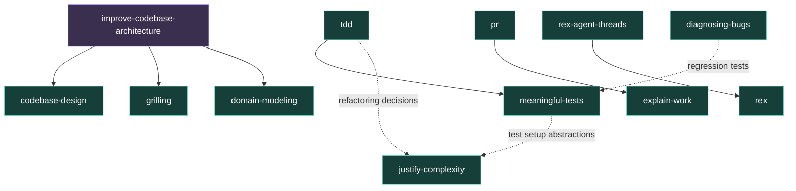

# Skills

## Source attribution

The skills below are adapted from external sources. Source links pin the adaptation baseline; use the tracking links when checking for updates.

### Matt Pocock update: v1.3.1

Reviewed all 24 attributed Matt Pocock skills and the existing local `pr` skill against [v1.3.1](https://github.com/mattpocock/skills/releases/tag/v1.3.1), commit `24fe0ef7737efae15c87225755e9f6f5965e4888`, from the baseline linked below. Applied changes to installed workflows while preserving local adaptations and invocation metadata:

- Adopted `GLOSSARY.md` / `GLOSSARY-MAP.md` and renamed the domain format reference to `GLOSSARY-FORMAT.md`.
- Added horizontal rules between grilling questions.
- Removed the router's stale automatic post-mortem handoff; architecture exploration remains a human choice.
- Kept the local `pr` / `explain-work` composition, adding the upstream domain-language guidance.
- Kept `ask-matt` scoped to installed workflows; added user-invoked `retro`, but did not install `implement-spec`. The removed `resolving-merge-conflicts` skill was not installed. Other release fixes were already present or superseded by local adaptations.

For repositories using the old domain-doc convention, rename `CONTEXT.md` to `GLOSSARY.md` and `CONTEXT-MAP.md` to `GLOSSARY-MAP.md`, then update repository pointers. This update does not migrate other repositories.

| Local skill | Pinned source | Track updates | Local adaptation |
| --- | --- | --- | --- |
| `codebase-design` | [`engineering/codebase-design`](https://github.com/mattpocock/skills/blob/885e2ca4d842d139e9aef4e48d366c63cb1b8013/skills/engineering/codebase-design/SKILL.md) | [`main`](https://github.com/mattpocock/skills/blob/main/skills/engineering/codebase-design/SKILL.md) | Matches upstream, including model invocation. |
| `diagnosing-bugs` | [`engineering/diagnosing-bugs`](https://github.com/mattpocock/skills/blob/885e2ca4d842d139e9aef4e48d366c63cb1b8013/skills/engineering/diagnosing-bugs/SKILL.md) | [`main`](https://github.com/mattpocock/skills/blob/main/skills/engineering/diagnosing-bugs/SKILL.md) | Retains diagnosis-only mode and conditional state-space analysis. |
| `domain-modeling` | [`engineering/domain-modeling`](https://github.com/mattpocock/skills/blob/885e2ca4d842d139e9aef4e48d366c63cb1b8013/skills/engineering/domain-modeling/SKILL.md) | [`main`](https://github.com/mattpocock/skills/blob/main/skills/engineering/domain-modeling/SKILL.md) | Matches upstream, including model invocation. |
| `grilling` | [`productivity/grilling`](https://github.com/mattpocock/skills/blob/885e2ca4d842d139e9aef4e48d366c63cb1b8013/skills/productivity/grilling/SKILL.md) | [`main`](https://github.com/mattpocock/skills/blob/main/skills/productivity/grilling/SKILL.md) | Uses the round-by-round frontier interview with a harness-agnostic research fallback. |
| `handoff` | [`productivity/handoff`](https://github.com/mattpocock/skills/blob/885e2ca4d842d139e9aef4e48d366c63cb1b8013/skills/productivity/handoff/SKILL.md) | [`main`](https://github.com/mattpocock/skills/blob/main/skills/productivity/handoff/SKILL.md) | Matches upstream. |
| `improve-codebase-architecture` | [`engineering/improve-codebase-architecture`](https://github.com/mattpocock/skills/blob/885e2ca4d842d139e9aef4e48d366c63cb1b8013/skills/engineering/improve-codebase-architecture/SKILL.md) | [`main`](https://github.com/mattpocock/skills/blob/main/skills/engineering/improve-codebase-architecture/SKILL.md) | Matches upstream, including the visual HTML report workflow. |
| `prototype` | [`engineering/prototype`](https://github.com/mattpocock/skills/blob/885e2ca4d842d139e9aef4e48d366c63cb1b8013/skills/engineering/prototype/SKILL.md) | [`main`](https://github.com/mattpocock/skills/blob/main/skills/engineering/prototype/SKILL.md) | Integrates outcomes with implementation issues and Feature Contracts. |
| `quality-code` | [Dillon Mulroy's `coding-standards`](https://github.com/dmmulroy/.dotfiles/blob/be8575f901b85100251080c1707e3f3c2966dcc9/home/.agents/skills/coding-standards/SKILL.md) | [`main`](https://github.com/dmmulroy/.dotfiles/blob/main/home/.agents/skills/coding-standards/SKILL.md) | Omits the `better-result` preference and retains local TypeScript edge-case guidance. |
| `research` | [`engineering/research`](https://github.com/mattpocock/skills/blob/885e2ca4d842d139e9aef4e48d366c63cb1b8013/skills/engineering/research/SKILL.md) | [`main`](https://github.com/mattpocock/skills/blob/main/skills/engineering/research/SKILL.md) | Uses background delegation when available and direct research otherwise. |
| `tdd` | [`engineering/tdd`](https://github.com/mattpocock/skills/blob/885e2ca4d842d139e9aef4e48d366c63cb1b8013/skills/engineering/tdd/SKILL.md) | [`main`](https://github.com/mattpocock/skills/blob/main/skills/engineering/tdd/SKILL.md) | Delegates test quality to `meaningful-tests`, chooses routine seams autonomously, and includes refactoring in the loop. |
| `wizard` | [`engineering/wizard`](https://github.com/mattpocock/skills/blob/885e2ca4d842d139e9aef4e48d366c63cb1b8013/skills/engineering/wizard/SKILL.md) | [`main`](https://github.com/mattpocock/skills/blob/main/skills/engineering/wizard/SKILL.md) | Matches upstream. |
| `writing-for-agents` | [`productivity/writing-for-agents`](https://github.com/mattpocock/skills/blob/885e2ca4d842d139e9aef4e48d366c63cb1b8013/skills/productivity/writing-for-agents/SKILL.md) | [`main`](https://github.com/mattpocock/skills/blob/main/skills/productivity/writing-for-agents/SKILL.md) | Replaces `writing-great-skills`; Codex metadata follows the changelog's model-invoked intent. |
| `untangle-codebase` | [Caldo's `untangle-codebase`](https://github.com/caldoai/skills/blob/442c29918339cc8dbf09ae27aaf17b05745465a3/skills/untangle-codebase/SKILL.md) | [`main`](https://github.com/caldoai/skills/blob/main/skills/untangle-codebase/SKILL.md) | Matches upstream; user-invoked whole-codebase refactor. |

## Invocation

Model-invoked skills may be selected autonomously and may be composed by other skills. User-invoked skills are deliberate top-level workflows or commands.

| Model-invoked | User-invoked |
| --- | --- |
| `codebase-design` | `bro` |
| `commit` | `design-taste-frontend` |
| `diagnosing-bugs` | `diverge` |
| `domain-modeling` | `handoff` |
| `explain-work` | `improve-codebase-architecture` |
| `grilling` | `ponytail` |
| `justify-complexity` | `ui-design-guidelines` |
| `meaningful-tests` | `untangle-codebase` |
| `pr` | |
| `prototype` | |
| `quality-code` | |
| `quality-python-code` | |
| `research` | |
| `rex` | |
| `rex-agent-threads` | |
| `tdd` | |
| `wizard` | |
| `writing-for-agents` | |

Caretomo-only skills (`ctm-worktrees`, `ctm-aws-accounts`, `ctm-terraform`, `ctm-notion-tickets`) live in the Caretomo container at `~/work/sind/caretomo/.agents/skills/`, outside this repository. `synced/` is managed by the Claude app and gitignored.

## Relationships

Solid arrows are same-workflow composition. Dashed arrows are conditional adapters or consultations rather than unconditional calls.

### Relationship details

| Skill | Relationship |
| --- | --- |
| `improve-codebase-architecture` | Composes `codebase-design`, `grilling`, and `domain-modeling`. |
| `tdd` | Owns red-green-refactor; delegates test quality to `meaningful-tests` and abstraction decisions to `justify-complexity`. |
| `meaningful-tests` | Owns test selection and evidence; consults `justify-complexity` for production abstractions introduced for testing. |
| `diagnosing-bugs` | Uses `meaningful-tests` guidance for the regression test that proves a fix. |
| `pr` | Composes `explain-work` for the change explanation. |
| `rex-agent-threads` | Builds on `rex` for sessions and panes. |

## Independent skills

Here, **independent** means the skill does not invoke, require, or hand off to another installed skill. It may still own internal reference files, and other skills may depend on it.

- `bro`
- `codebase-design`
- `commit`
- `design-taste-frontend`
- `diverge`
- `domain-modeling`
- `explain-work`
- `grilling`
- `handoff`
- `justify-complexity`
- `ponytail`
- `prototype`
- `quality-code`
- `quality-python-code`
- `research`
- `rex`
- `ui-design-guidelines`
- `untangle-codebase`
- `wizard`
- `writing-for-agents`
